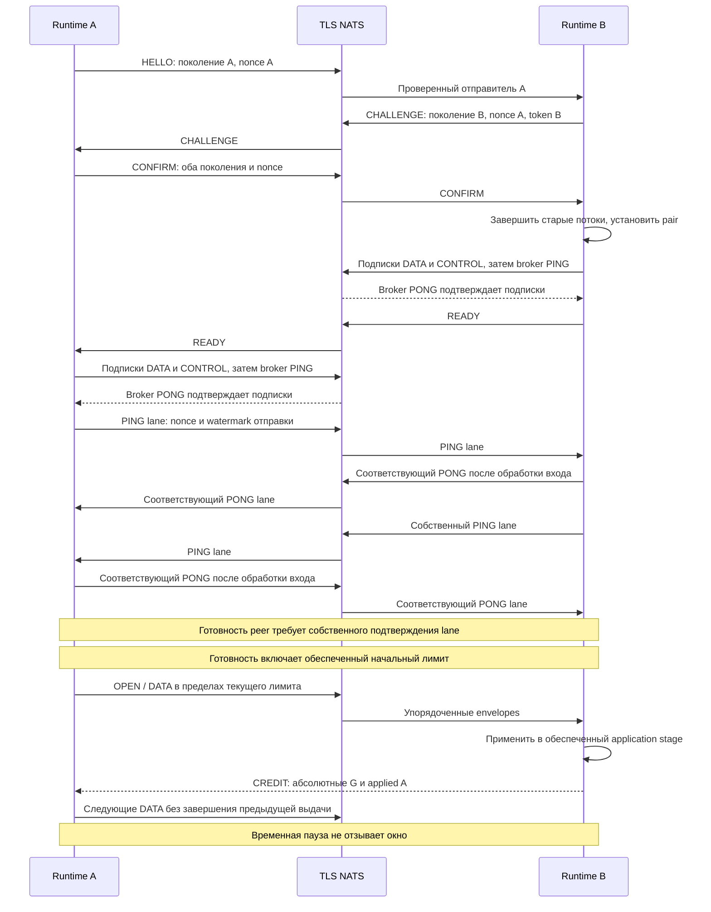

# Динамический NATS runtime

`skvoz_core::runtime::NatsRuntime` — опциональный runtime одной универсальной
Core library 5.0.0. Он добавляет authenticated join, смену peer session, проверку
живости и восстановление транспорта для новых byte streams. Включается feature
`nats`; HTTP/SOCKS parsing, DNS, сокеты, GUI и выдача credentials принадлежат host.
Статический [NatsNode](../core/src/nats.rs) остаётся low-level adapter для
статических транспортных сценариев стенда, без automatic join/recovery.
Минимальный TCP relay использует тот же NatsRuntime/protocol3, что и приложения.

## Подключение из приложения

```rust
use skvoz_core::{Config, ManagerConfig, PeerId};
use skvoz_core::runtime::{Authentication, Membership, NatsRuntime, RuntimeConfig, Trust};
use std::collections::BTreeSet;

async fn connect() -> Result<NatsRuntime, Box<dyn std::error::Error>> {
    let auth = Authentication {
        username: std::env::var("NATS_USERNAME")?,
        password: std::env::var("NATS_PASSWORD")?,
};
let mut config = RuntimeConfig::new(
    "tls://nats.example.org:4222", Trust::System, auth,
    "skvoz.application", PeerId(1),
    Membership::Allowlist(BTreeSet::from([PeerId(0)])),
);
config.initiate = vec![PeerId(0)];
let limits = ManagerConfig {
    stream: Config { max_metadata: 512, ..ManagerConfig::default().stream },
    ..ManagerConfig::default()
};
Ok(NatsRuntime::connect(config, limits).await?)
}
```

Компилируемый пример встраивания: [runtime_profile.rs](../core/examples/runtime_profile.rs).
Приложение вызывает `turn` и извлекает события, прежде чем полагаться на `peer_ready`.
`RuntimeConfig::validate_profile(limits)` проверяет профиль без I/O и возвращает
настроенную границу транспортной нагрузки. [Отдельный демон с IPC](daemon-ipc.md)
использует тот же runtime для приложений на других языках.

`Trust::System` использует native trust store. `ManagedCa(PathBuf)` использует
проверенный app-specific PEM bundle, без глобальной установки корня.
Проверка цепочки, срока и hostname обязательна. Runtime принимает provisioned
username/password; JWT/NKey credentials в этом профиле не поддерживаются.
Передача профиля, хранение/отзыв credentials, первоначальное доверие и обновление
сертификата — обязанности provisioner/host. TLS не выдаёт сертификаты и не
позволяет доверять произвольному скачанному CA. URL с embedded userinfo запрещён;
Debug конфигурации и typed errors не раскрывают endpoint или пароль.

## Профиль транспорта

Подключение выполняется в обычном порядке NATS `INFO → TLS → CONNECT` во всех
соединениях: join, transport lanes и восстановление. Открытым остаётся только
начальный `INFO` с метаданными брокера. Пароль и payload передаются после
проверенного TLS; `require_tls(true)` запрещает открытый транспорт.
Брокер должен отправлять `INFO` до TLS (`tls.handshake_first: false`).
Брокер с другим порядком приветствия требует согласованного изменения
конфигурации. Проверка TLS обязательна; автоматического перехода на открытый транспорт нет.

`RuntimeConfig.tls_server_name: Option<String>` задаёт ожидаемую TLS-идентичность
со значением `None` по умолчанию. Приложение может подключаться к
`tls://127.0.0.1:4222`, проверяя явно заданный публичный IP-адрес или домен
в SAN сертификата. Штатный `WebPkiServerVerifier` по-прежнему проверяет
цепочку сертификатов, срок действия, SAN и подписи при установлении соединения;
меняется только ожидаемое имя или IP-адрес. `System` загружает системные корни
и прекращает подключение при ошибке загрузки. `ManagedCa` проверяет доверие
только по переданным корням PEM; пустые, недоверенные или некорректные корни
приводят к отказу. В текущем async-nats 0.50 загрузка системных корней
выполняется также до применения собственной конфигурации TLS, поэтому
повреждённое системное хранилище может помешать даже режиму `ManagedCa`.
Это безопасный отказ без перехода к посторонним корням доверия.
Параметр не меняет SNI из URL и не добавляет маршрутизацию TLS
по виртуальным хостам. Без параметра сохраняется проверка имени из URL.
[Профили демона](daemon-ipc.md) предоставляют то же необязательное поле.

NATS должен объявлять `max_payload: 65588` для совместного bounded provisioning. Core ограничивает собственный envelope16460bytes независимо от этой величины. Runtime отвергает и меньший, и больший
лимит, чтобы count-bounded inbound queues имели конечную границу payload bytes.
При общем брокере этот профиль необходимо согласовать с другими приложениями.

## API коннектора

Обе стороны используют один интерфейс. Операции над потоком синхронно ставят
работу в ограниченные очереди; приложение обслуживает её через async `turn`.

| Задача приложения | Метод |
| --- | --- |
| Подключить runtime с профилем TLS/auth и лимитами | `NatsRuntime::connect(config, limits).await` |
| Начать соединение с разрешённым peer / проверить его готовность | `join_peer(peer)` / `peer_ready(peer)` |
| Открыть поток, передав непрозрачные metadata назначения | `open(peer, metadata)` → `RuntimeKey` |
| Принять или отклонить входящий поток | `accept(key, metadata)` / `reject(key, reason)` |
| Поставить байты на отправку | `send(key, bytes)` → `Accepted(n)` или `WouldBlock` |
| Получить события потока | `poll_events(max)` → `Vec<RuntimeEvent>` |
| Ограничить передачу DATA доступной ёмкостью host | `poll_events_with_data_budget(max, admit)` |
| Подтвердить обработку полученных байтов | `consume_through(key, end_offset)` |
| Завершить отправляющее направление / отменить поток | `finish(key)` / `close(key)` |
| Обслужить транспорт, negotiation и таймеры | `turn(wait).await` |
| Прервать только ожидание idle-транспорта по готовности внешнего I/O | `turn_with_wake(wait, wake).await` |
| Прочитать локальный профиль / проверенные лимиты удалённого потока | `limits()` / `peer_limits(key)` |
| Получить состояние / подробные данные о буферах | `status()` / `resources()` |
| Прочитать локальное поколение runtime | `epoch()` |
| Допустить peer с ожидаемым поколением | `authorize_peer(peer, expected_epoch)` |
| Завершить peer / отозвать его локальное разрешение | `terminate_peer(peer)` / `revoke_peer(peer)` |
| Завершить работу runtime | `shutdown().await` |

`RuntimeEvent` содержит ключ и событие, например `IncomingOpen`, `Opened`, `Data`,
`Writable`, `RemoteFinished` или `Closed`. После `IncomingOpen` серверный коннектор
сам открывает целевой сокет и подтверждает поток через `accept`. Кодирование
адреса в metadata принадлежит коннекторам.

`Accepted(n)` может обозначать только часть предложенного буфера: остаток хранит
приложение. Получение `Data` не возвращает кредит. `consume_through` подтверждает
абсолютную конечную позицию действительно обработанных байтов. `finish` допускает
ответ второй стороны после EOF; `close` отменяет поток. Подробный byte-credit/EOF
контракт определён в [движке](stream-engine.md).

`limits()` возвращает настроенный `ManagerConfig`, а `peer_limits(key)` —
`PeerLimits { receive_window, max_frame }` из проверенного OPEN или ACCEPT.
Для отсутствующего потока или устаревшего epoch/incarnation возвращается `None`.
Эти операции не меняют лимиты и не требуют I/O. Коннектор может отвергнуть
несовместимый профиль до выделения своих буферов.

При отсутствии работы `turn` ждёт готовности существующих подписок NATS и
ближайшего transport timer. Пришедшее сообщение обрабатывается до возврата
из ожидания. `turn_with_wake` также принимает `Future<Output = ()>` от host:
он опрашивается только в idle-ветке после завершения передачи извлечённых
output frames. Готовность host завершает это ожидание с нулевым transport
progress; обработка внешнего I/O остаётся обязанностью коннектора.
Host должен ожидать завершения всего turn. Внешний `select` с отменой активного
turn может потерять владение уже извлечёнными output frames и завершить транспорт.

Активная часть turn имеет один абсолютный предел `io_timeout`: в него входят
регистрация подписок, публикации и flush. При истечении срока runtime завершает
текущее транспортное поколение до возврата `RuntimeError::Timeout`; прикладные
данные извлечённых кадров не повторяются в новом сеансе. Штатное ожидание idle
учитывается отдельно и может длиться дольше `io_timeout`, сохраняя здоровый
транспорт. Готовность host или ближайший срок маршрута прерывают только это
ожидание; начатая активная часть завершается в своём ограниченном сроке.

`join_peer` идемпотентен для pending flight. Для уже ready peer прямой Core API
начинает новую negotiation: подтверждённая pair session replacement закрывает
старые streams. Host не должен считать повторный `join_peer` harmless connect.
IPC JOIN, напротив, обеспечивает готовность и является no-op для ready peer,
чтобы другой local owner не прерывал текущий обмен.

## Выдача прав и идентичность

Broker permissions должны связывать sender PeerId, recipient PeerId и shard.
Полученный subject без таких ACL не доказывает authenticated identity.
`Allowlist` дополнительно ограничивает принимаемые PeerId. `BrokerAuthorized`
разрешает новые broker-authorized identities в пределах `ManagerConfig.max_peers`,
включая pending joins. Это явный контракт доверия к provisioning брокера;
пересоздавать сервер для нового разрешённого клиента не требуется.

В профиле `Allowlist` host может добавлять разрешённый peer через
`authorize_peer(peer, Some(epoch))`. Runtime принимает JOIN только этого
поколения удалённого Core. Замена активного поколения требует сначала явного
отзыва; вызов с другим ожидаемым epoch возвращает ошибку. `None` задаёт обычное
разрешение ID без ограничения поколения. API отклоняет собственный PeerId,
нулевой ожидаемый epoch и превышение `max_peers`; для `BrokerAuthorized`
динамическая выдача разрешения не применяется. `revoke_peer` удаляет также
ожидаемое поколение. Проверка дополняет брокерные ACL и не выдаёт credentials.

Темы NATS:

```text
<namespace>.join.<recipient>.<sender>
<namespace>.lane.<recipient>.<recipient-generation>.<shard>.data.<sender>.<sender-generation>
<namespace>.lane.<recipient>.<recipient-generation>.<shard>.control.<sender>.<sender-generation>
```

Все участники namespace используют один `shards` profile; shard вычисляется как
`sender PeerId % shards`. Например, при восьми shards, server PeerId0 и client
PeerId1 provisioner даёт клиенту publish только в `join.0.1` и
`lane.0.*.1.*.1.*`; server publish — в `join.*.0` и `lane.*.*.0.*.0.*`.
Subscribe разрешается только на собственный recipient, с необходимыми wildcard
для generations/shards/senders. Namespace prefix также ограничивается ACL.
У другого client нет права подменить sender1, читать recipient1 или публиковать
в чужой shard. Не выдавайте blanket publish/subscribe `>` и automatic reply
permissions, расширяющие эту границу. В NATS пустой allow-list не означает deny-all;
для роли без полномочий нужен явный `deny: [">"]`.

Broker/operator входит в доверенную границу: payload не зашифрован отдельно
между Core instances. Прикладной TLS внутри CONNECT сохраняет собственную проверку доверия.
Скомпрометированная/дублированная credential той же identity может заменить её
session; runtime не заменяет credential revocation.

## Присоединение, замена и готовность

Control v3 — ровно200bytes: `SKC3`, kind, reserved zero и binding sender/recipient generations, hello nonce, pair token. Затем watermark, command serial, applied-control receipt, ledger epoch, record boundary и applied byte/record prefix. Последние72bytes содержат length, reserved и bounded semantic control. DATA — `SKD3` header48 и прежний проверяемый semantic stream frame wire2. Старые outer envelopes не поддерживаются. Точные поля и векторы — [runtime protocol](runtime-protocol.md).

Node generation, initiator nonce и responder challenge генерируются OS randomness.
HELLO инициирует CHALLENGE; CONFIRM связывает обе generations и оба challenges;
READY завершает negotiation. Responder challenge становится pair-session token.
Повтор текущей flight идемпотентен, pending handshake имеет finite deadline.
Если оба peer одновременно начинают join, выигрывает инициатор с меньшим PeerId.
Старый HELLO может вызвать только новый bounded challenge, но не смену активной
session. Старый CONFIRM/READY/PONG или DATA не проходят текущие bindings.

При подтверждённой замене runtime аварийно завершает старые streams, выдаёт
terminal events и ждёт их drain. Затем снимает старую Manager registration,
создаёт новую pair session и новый local incarnation. Сохранённый `RuntimeKey`
содержит `(node epoch, peer incarnation, StreamKey)`; старые send/consume/close
возвращают `StaleKey`, даже если новый wire stream ID совпал. Incarnation и frame
sequence проверяются на overflow. Ранее выданные buffers остаются у host.

`async-nats::Client.flush()` завершает локальную запись socket buffers; это не
broker PONG и не доказательство установленной subscription. DATA SUB создаётся
до CONTROL SUB на той же connection; отдельный `broker_barrier()` ждёт PONG на
свой broker PING. Responder устанавливает подписки перед READY, инициатор —
после READY. Затем инициатор отправляет первый lane PING; responder начинает
свою проверку только после этого сообщения. Успешный lane roundtrip подтверждает
путь между peer, включая распространение интереса через leaf. После negotiation
peer остаётся неготовым до собственного matching nonce PONG на новой lane.
PING/PONG на установленной lane публикуются однократно; отсутствие ответа
завершает peer в пределах исходного deadline. `peer_ready` и `open` требуют
этого доказательства. Initial HELLO допускает до3 публикаций с интервалом не менее250ms, поскольку remote interest может ещё не существовать. Остальные phases публикуются один раз на отдельном соединении; отсутствие ответа завершает phase по абсолютному deadline. Новая попытка создаёт новый nonce. Начальное обеспеченное delivery permission передаётся с lane readiness, без дополнительной credit-транзакции перед первым OPEN.

Доказательство готовности локально: одна сторона может уже видеть ready,
пока другая ещё ждёт своего PONG. Полученный authenticated OPEN и действующий
ключ в этот момент не означают потерю поколения. Коннектор удерживает
согласование в пределах своего deadline и проверяет собственный `peer_ready`
перед активацией внешнего I/O.



Host обязан регулярно вызывать `turn` и `poll_events`. Если terminal events не
дренированы за `terminal_drain_timeout`, runtime публикует
`TerminalDrainTimeout`, прекращает replacement flights и сохраняет ограниченную
старую terminal registration до drain. Он не выбрасывает уведомления и не
накапливает поколения. При global recovery такой stall переводит lifecycle в
`Failed`; при peer replacement другие peers могут продолжать работу.

## Живость и восстановление

DATA envelope содержит pair token u128 и последовательный frame sequence u64.
Разрыв sequence завершает peer. PING содержит nonce и число dispatched frames;
PONG разрешён только после применения всех входящих frames до watermark.
Ожидание DATA при опережающем CONTROL занимает один coalesced pending slot.
Это подтверждение применения входа, не потребления buffers коннектором.
Потерянный последний frame не маскируется живым брокером или lost overflow callback:
его watermark не подтверждается. Slow reader, который продолжает driving Core,
и полностью idle peer отвечают на heartbeat независимо от выдачи byte credit.

Missing PONG завершает peer после configured deadline. Наблюдаемый bound включает
heartbeat interval, peer timeout, bounded peer visitation и host driving/I/O delay.
Runtime не исполняется сам без host turns. Peer slots обслуживаются bounded
rotation; driver не сканирует все idle streams. Manager сохраняет indexed opening
deadlines. На установленной lane каждый PING/PONG публикуется однократно.
Потеря управляющего сообщения может завершить peer даже после восстановления
leaf: получение подтверждения нельзя заменять предположением о доставке.

Global join-transport loss переводит `Ready -> Recovering`: старый Manager
остаётся terminal, events дренируются, затем создаются новый Manager и generation.
Retries используют bounded exponential delay+jitter; после `max_retries` — `Failed`.
Authentication/authorization failure terminal; host должен исправить provisioning
и создать новое подключение. Брокер может быть ready при ещё неготовом peer:
проверяйте `peer_ready`, а не только lifecycle. Не возобновляются старые bytes.

`terminate_peer` завершает локальную session. `revoke_peer` запрещает будущий join
только для `Allowlist`; с `BrokerAuthorized` возвращает `Config`, потому что
broker credential revocation принадлежит provisioner. Ошибки разделены на Config,
Tls, Authentication/Authorization, Timeout, Admission, PeerUnavailable, StaleKey,
Transport/Protocol и безопасные Manager errors.

## Очереди, изоляция и состояние

Права доставки непрерывны и абсолютны. Для направления peer сохраняются granted boundary G, committed S, локальный pending P и actually applied A; `A<=S`, `S+P<=G`. Стоимость — размер envelope+1024bytes и одна запись. Receiver проверяет оба измерения. Его обязательство `G-A` входит в общий input pool всех lanes, включая карантин retiring sources. Sender отдельно ограничивает общий `S-A` всех получателей; это защищает общий native leaf при download. При receipt проверяется точная граница ранее committed envelope.

После применения DATA payload переходит в отдельный обеспеченный Manager/application stage. ACK доставки не освобождает непрочитанный payload. `consume_through` вызывается только после фактического освобождения bytes коннектором. Network сохраняет единый byte-stream API для TCP proxy и framed IP records; Core IP-пакеты не разбирает.

Bootstrap составляет до4КиБ/2envelopes при доступном backing. Известный активный спрос запрашивает target256КиБ/32records. Target растёт при реальном применении; выдача ограничена свободным shared backing. Snapshot обновляет разрешение заранее, обычно после освобождения четверти target. Неиспользованный grant остаётся за peer во время короткой паузы. Старые REQUEST/RETURN rounds отсутствуют.

При конкурирующем спросе и дефиците разрешение редкого idle victim отзывается FENCE. Sender останавливает новые резервации, завершает уже reserved prefix и отвечает FROZEN. Receiver не освобождает остаток, пока ordered DATA не достигнет exact prefix. Затем начинается следующий epoch; timer не переиспользует неизвестный flight. Истечение самостоятельного control/fence deadline завершает peer.

Один sequenced control snapshot на направление peer ограничивает служебный flight. CREDIT может включать bounded semantic peer credit, stream window update или RESET. RESET несёт source DATA watermark; получатель ждёт его перед применением, в одном pending slot. OPEN/ACCEPT/FIN сохраняют порядок DATA. Receipt находится в следующем DATA/control либо отдельном unsequenced RECEIPT, который не требует ответного receipt. Неподтверждённый command имеет абсолютный peer timeout; heartbeat его не продлевает.

Broker pending остаётся4МиБ. Для configured max peers N заранее резервируется `N*12*(200+1024)` на служебные сообщения и один maximum DATA16460+1024. Общий обычный delivery budget — минимум остатка и3МиБ, record budget2048. Runtime допускает до128 configured peers. Reserve закладывает будущие admitted/retiring slots до выдачи permissions; каждый shard не получает собственные независимые3МиБ. Поддерживается один полный сервер и native leaf/intermediate путь без постороннего payload publisher/fanout в APP account; произвольная multi-server topology требует отдельного domain allocator.

Retirement снимает exact-source subscriptions, ждёт broker barrier и дренирует зафиксированный old DATA queue prefix. Неизвестный исход publication остаётся в quarantine. Общий outgoing debt сохраняется до свежего authenticated pair proof, после безопасной замены source на другой стороне; длительно исчезнувший peer может удерживать часть доступного flight. Отсутствие безопасного backing даёт backpressure/admission failure. Дедлайн сам не удаляет долг.

Lane data/control subscriptions используют две общие bounded queues, а не две очереди на каждый peer. Максимум payload16460 применяется до allocation независимо от INFO max_payload65588. INFO ограничен4096bytes, остальные строки512; HMSG отвергается до создания HeaderMap. Обеспеченный transport backing:

```
(join_capacity + 2*shards*subscription_capacity
 + (shards+1)*client_capacity + 4*(shards+1)) * (16460+1024)
 + max_peers*(34816+2048)
```

Последнее слагаемое — delivery/control state с bounded exact-prefix endpoints и exact-source subscription metadata. Bounded committed-prefix record metadata входит в transport accounting. TLS, kernel buffers, broker и caller-owned payload оцениваются отдельно; эта формула не является RSS процесса.

Горячий scheduler работает с ready peers/streams и byte deficits. Число streams одного peer не увеличивает его верхний вес. DATA batch ограничен32envelopes,256КиБ и cooperative time slice около1ms; peer control имеет отдельные bounded slots и rotation, а ожидание publication допускает progress чтения; первый frame не ждёт наполнения batch. Pending publish/flush продолжает входное чтение. Не завершившийся extracted batch guarded и консервативно завершает затронутые lanes при отмене. Idle streams не имеют собственных задач/таймеров.

`peer_status` показывает delivery epoch, granted/sent/applied bytes, свободные records, command sequences и delivery/control wait. `snapshot` сохраняет отдельное application/send состояние. `stream_diagnostics(key)` добавляет возраст непрерывно непустой send-очереди, application/local-budget flags, ожидание delivery/shared-flight/control и eligibility планировщика для выбранного stream. Это query без background scan; elapsed output/turn включает совместную обработку I/O и не является временем удалённого приложения. `TurnDiagnostics` измеряет этапы owner turn; transport publish counters не подтверждают consume. Диагностические полные snapshots могут стоить O(stream count).

[Локальная поправка async-nats](../vendor/async-nats/PATCHES.md) удерживает одну pending Message при заполненной subscription, продолжая write/flush/commands/heartbeat. После io_timeout connection закрывается; silent DATA drop недопустим. Статический экспериментальный NatsNode имеет свой отдельный documented contract.

## Воспроизводимая квалификация

[Первый запуск](getting-started.md#независимые-процессы-runtime) описывает `check`
и `qualify`: реальные TLS/auth/ACL, restart/rejoin, silent peer, tiny-queue overflow,
replay/stale keys, credential revocation и native trust. Test-only
`fault-injection` включён только `skvoz-testbench/real-nats`; обычный `nats` и
release `qualify` его не включают. Lost final DATA и cancelled extraction tests
явно inject failure; они не доказывают реальную потерю async-nats callback.

Qualification запускает отдельный release server и client processes, измеряет
server/client applications и broker отдельно. Delay forwarder задерживает реальные
TLS bytes, но также pacing8KiB chunks; это не полная эмуляция WAN. Hold после
active transfer проверяет bounded idle/liveness soak, не непрерывный traffic soak.
Local runs не устанавливают users/throughput/latency, mobile или whole-host SLA.


## Встраивание в сетевой runtime

[Общий TCP/IP runtime](network-runtime.md) встраивает один NatsRuntime и
единолично управляет событиями Core. Host на Ruby/GTK передаёт только команды;
обычные sockets/TUN и кредит после фактической записи обслуживает Rust.
Самостоятельный daemon/IPC остаётся независимым компонентом.

Публичный `verified_tls_config(&Trust, identity)` строит тот же проверяемый
ClientConfig для host, которому нужен dial на заранее подтверждённый numeric IP,
например enrollment при активном capture. Identity остаётся исходным DNS/IP SAN;
проверка цепочки и подписей TLS сохраняется. Host отвечает за фиксированный
адрес и lifecycle; этот builder не добавляет маршрутизацию в Core.

Для библиотечного host доступны `set_diagnostics_enabled(bool)` и
`diagnostics() -> TurnDiagnostics`. По умолчанию сбор выключен: дополнительные
временные метки не снимаются. Изменение ON/OFF сбрасывает накопленные значения;
повторный ON сохраняет текущий сбор. Счётчики принадлежат одному объекту runtime
и сохраняются при его внутреннем recovery/rejoin; замена объекта начинает новый
сбор. `turns` и `progress` относятся к вызовам в Ready и работе до idle.
`turn_us`, `output_us`, `idle_us` — прошедшие микросекунды, включая ожидания;
idle также включает обработку прибывших сообщений. Это не CPU time и не
независимые слагаемые: idle/output входят в turn. Формат Core wire не меняется.
