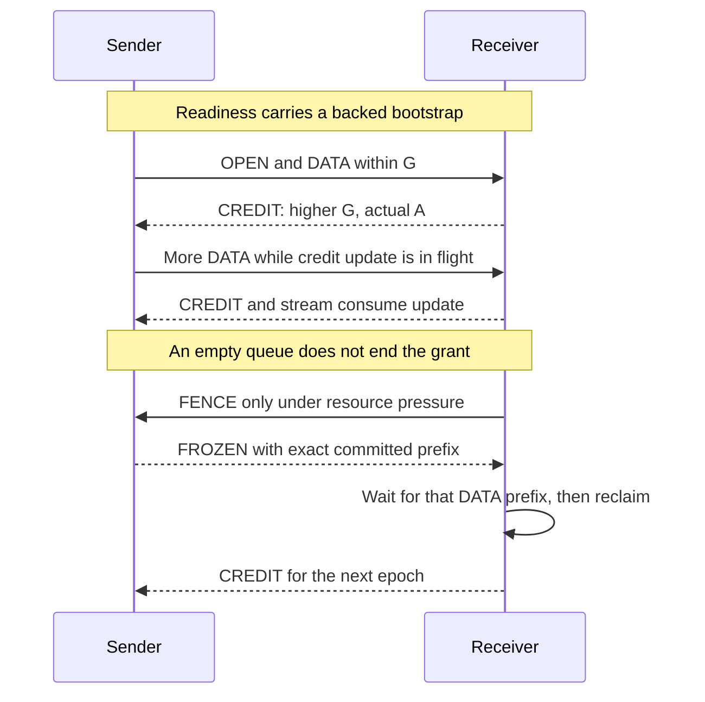

# Runtime protocol3

Core5 uses one byte-stream service for proxy traffic and framed VPN traffic. The network connector owns IP framing and policy. The NATS adapter owns authenticated pair sessions, continuous delivery permissions and bounded control. This outer protocol is incompatible with runtime2. The inner [semantic stream codec2](wire.md) keeps its byte layout.

All integers are unsigned, big-endian and checked for overflow. Source identity comes from the exact authenticated NATS subscription and current pair token. Peers must use the same shard count. NATS headers/reply subjects and transport replay are unsupported.

## DATA envelope

| Offset | Bytes | Field |
| --- | --- | --- |
| 0 | 4 | `SKD3` |
| 4 | 16 | pair token |
| 20 | 8 | source sequence, starting at1 |
| 28 | 8 | last fully applied opposite control sequence |
| 36 | 8 | delivery ledger epoch |
| 44 | 4 | exact remaining body length |
| 48 | variable | one checked semantic frame |

Runtime DATA payload is at most16KiB; metadata is at most512bytes. Maximum complete envelope is16460bytes. Gaps and duplicates terminate the source peer. No reorder map, retry or stream resumption is provided. FIN stays ordered after its preceding bytes.

Each committed envelope costs its exact payload length plus1024 conservative NATS/leaf framing bytes and one record. A delivery receipt is an exact previously committed envelope boundary. Payload remains in the separate application budget until the connector consumes it.

## Control envelope

Every SKC3 control is exactly200bytes. Unknown kinds, nonzero reserved bytes, inconsistent lengths and nonzero unused body bytes fail validation.

| Offset | Bytes | Field |
| --- | --- | --- |
| 0 | 4 | `SKC3` |
| 4 | 1 | kind |
| 5 | 3 | reserved zero |
| 8 | 16 | sender generation |
| 24 | 16 | recipient generation |
| 40 | 16 | hello nonce or prefix, depending on kind |
| 56 | 16 | pair token |
| 72 | 8 | watermark or absolute allowed byte boundary |
| 80 | 8 | sequenced command serial; zero for unsequenced control |
| 88 | 8 | last fully applied opposite command serial |
| 96 | 8 | credit epoch |
| 104 | 8 | absolute record boundary |
| 112 | 8 | applied byte boundary |
| 120 | 8 | applied record boundary |
| 128 | 1 | used control-body length,0…64 |
| 129 | 7 | reserved zero |
| 136 | 64 | control body, unused suffix zero |

| Kind | Meaning |
| --- | --- |
| 1…4 | HELLO, CHALLENGE, CONFIRM, READY |
| 5,6 | peer PING/PONG with matching nonce and committed DATA watermark |
| 7 | advisory DEMAND; watermark is requested target bytes, records is requested record capacity |
| 8 | absolute CREDIT snapshot: epoch, allowed bytes/records, actually applied bytes/records |
| 9 | FENCE requesting the next epoch |
| 10 | FROZEN: final committed weighted bytes/records and DATA sequence in hello |
| 11 | unsequenced applied-control RECEIPT |
| 12 | CLOSE: immutable committed DATA sequence in watermark, weighted bytes in applied_bytes, records in records; hello binds the terminal exchange |
| 13 | CLOSE_ACK: same fields for the reverse committed prefix |
| 14 | CLOSE_DONE: terminal exchange binding, remaining prefix fields zero |

Kinds7…10 use one outstanding serial per direction. Later state stays local until receipt. CREDIT may additionally carry one semantic peer credit/request/freeze, stream WINDOW update/grant or RESET; hello is then the last committed source DATA sequence. The receiver holds one pending control until that prefix has been applied. It acknowledges the command only after the full action, including the attached semantic frame. OPEN, ACCEPT, REJECT and FIN remain on ordered DATA.

Readiness PING/PONG can carry a16-byte bootstrap body: backed allowed weighted bytes u64 and records u64, bounded by4096/2. It initializes only an empty epoch0 sender ledger. After readiness, a short OPEN can use this permission without a separate delivery request round.

RECEIPT needs no receipt. Other established controls and DATA can piggyback its cumulative value. A pending command has an absolute deadline independent of heartbeat. The host must drive complete turns regularly; deadlines are not real-time guarantees when its driver is stalled.

## Continuous grants and reclaim

For each sender, `A<=S` and `S+P<=G`: applied prefix A, committed prefix S, proven local pending P and granted boundary G. Receive obligation is `G-A`. Temporary absence of output retains permission. Applied delivery and actual application consume are separate stages.

Shared input grants and shared output flight cover all lanes and recipients of one complete server. Bytes and records are independent limits. Retired sources and unknown publication outcomes stay charged until a safe barrier or new pair proof; expiration alone never frees them.

FENCE stops new reservations. FROZEN reports the final committed prefix after pending reservations drain. The receiver waits for that exact DATA prefix before reclaiming unused permission and changing epoch. A new epoch cannot remove backing for unread application bytes.

See [NATS runtime](nats-runtime.md) for budgets, source retirement, liveness and embedding. Public [golden vectors](../core/tests/fixtures/runtime-v3.tsv) define representative bytes; unit and real-NATS tests cover distinct state and I/O behavior. Local tests do not establish an Internet throughput guarantee.

## Terminal ownership

Administrative peer retirement uses a three-message terminal fence independent of DATA permission. CLOSE stops new application admission and DATA reservations. Both sides retain and apply/discard already committed DATA under the old delivery ledger. The responder drains the CLOSE prefix and its Manager terminal events before sending CLOSE_ACK with its own final committed prefix. The initiator releases its outgoing debt on this proof, drains the reverse prefix and local terminal events, then sends CLOSE_DONE. The responder releases its outgoing debt only on DONE. Exact subscriptions are removed and their broker barrier/old queue prefix completed before reporting local cleanup.

The administrative deadline remains3seconds in the product profile. Missing prefixes or lost terminal controls fail closed, retain unknown debt and cannot acknowledge successful revoke. A failed zero-byte terminal exchange also retains a bounded failure marker. Concurrent close uses the lower PeerId as leader and preserves the original deadline. No timer releases unknown data; reconnect starts a fresh pair. Hosts must keep driving events and native cleanup throughout this exchange.
